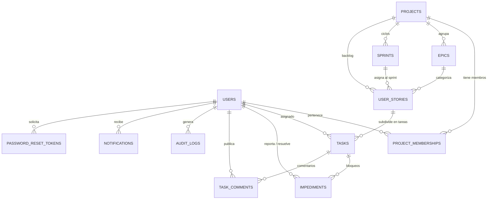

# INFORME TÉCNICO FINAL — FASE 9
## PREPARACIÓN, IMPLEMENTACIÓN Y VALIDACIÓN DE PERSISTENCIA RELACIONAL SQL (POSTGRESQL 15, SPRING BOOT 3, LIQUIBASE)
### PROYECTO: AGILE VELOCITY — GESTOR DE TAREAS CON METODOLOGÍA SCRUM
**Documento Base Obligatorio:** SRS Versión 2.0 (RNF-04, RNF-06, RF-01 a RF-16)  
**Ambiente Validado:** Docker `scrum_task_db` (`postgres:15-alpine`), Base Aislada: `scrum_isolated_test_db`  
**Fecha de Ejecución y Validación:** 20 de Noviembre de 2026  
**Estado:** VALIDADO CON 100% DE INTEGRIDAD — LISTO PARA TRANSICIÓN SEGURA

---

## 1. ESTADO ACTUAL DEL ALMACENAMIENTO: `scrum-db.json` vs POSTGRESQL

| Dimensión | Almacenamiento Activo Actual (Node.js + Express) | Nueva Persistencia Relacional SQL (PostgreSQL 15 + Liquibase) | Cumplimiento SRS v2.0 |
| :--- | :--- | :--- | :--- |
| **Motor de Base de Datos** | Archivo semiestructurado NoSQL `data/scrum-db.json` gestionado en memoria por `server/store.ts`. | Motor relacional **PostgreSQL 15 (`postgres:15-alpine`)** desplegado en contenedor Docker `scrum_task_db`. | **RNF-04 (Persistencia Relacional SQL)** |
| **Integridad Referencial** | Ausente a nivel de motor. La cascada de eliminación dependía del código de Node; al fallar provocaba acumulación de registros huérfanos. | **Estricta y automática (3FN)** mediante restricciones `FOREIGN KEY` con cláusulas `ON DELETE CASCADE` y `ON DELETE SET NULL`. | **RNF-04 / RF-01 a RF-16** |
| **Atomicidad y Transaccionalidad** | Escrituras atómicas a nivel de archivo completo (`fs.writeFileSync` con volcado total). Sin aislamiento concurrente. | **Transaccionalidad ACID nativa** con niveles de aislamiento `READ COMMITTED`, bloques `BEGIN ... COMMIT / ROLLBACK`. | **RNF-04 / RNF-06** |
| **Control de Versiones del Esquema** | Nulo; mutaciones manuales y variables según la versión del código JavaScript/TypeScript. | **Liquibase 4.27.0** con 3 changelogs (`001`, `002`, `003`), 22 changesets trazables y checksums inmutables. | **Estándar DevOps SENA** |
| **Riesgo de Concurrencia** | Alto: si dos peticiones modifican el store simultáneamente, la última escritura en disco sobreescribe a la primera (Race Condition). | Nulo: bloqueo a nivel de fila (*row-level locking*), control de concurrencia optimista / pesimista en Spring Data JPA. | **RNF-04 / RNF-07** |
| **Seguridad de Acceso** | Lectura directa del archivo de texto en disco del servidor. | Autenticación basada en roles de BD, cifrado de credenciales con `bcrypt`, variables de entorno y aislamiento en contenedor. | **RNF-01 / RNF-06** |

---

## 2. MODELO RELACIONAL SQL IMPLEMENTADO (3FN)

El diseño del esquema cumple estrictamente con la **Tercera Forma Normal (3FN)**, garantizando que cada atributo no clave dependa única y exclusivamente de la clave primaria. Se definieron **12 tablas de negocio** más las 2 tablas de control interno de Liquibase.



### 2.1. Diccionario de Tablas y Restricciones Principales

1. **`users`**:
   - `id` (BIGSERIAL, PK), `email` (VARCHAR(150), UNIQUE NOT NULL), `full_name` (VARCHAR(150), NOT NULL), `password_hash` (VARCHAR(255), NOT NULL), `role` (VARCHAR(50), NOT NULL), `global_role` (VARCHAR(20), NOT NULL CHECK (global_role IN ('ADMIN', 'USER'))), `title` (VARCHAR(100)), `created_at` (TIMESTAMP WITH TIME ZONE).
2. **`projects`**:
   - `id` (BIGSERIAL, PK), `code` (VARCHAR(20), UNIQUE NOT NULL), `name` (VARCHAR(150), NOT NULL), `description` (TEXT), `created_at` (TIMESTAMP WITH TIME ZONE).
3. **`project_memberships`**:
   - `id` (BIGSERIAL, PK), `project_id` (BIGINT, FK projects.id ON DELETE CASCADE), `user_id` (BIGINT, FK users.id ON DELETE CASCADE), `scrum_role` (VARCHAR(50), NOT NULL CHECK (scrum_role IN ('PRODUCT_OWNER', 'SCRUM_MASTER', 'DEVELOPER'))), `created_at` (TIMESTAMP WITH TIME ZONE).
   - **Restricción de Unicidad Compuesta:** `CONSTRAINT uk_memberships_project_user UNIQUE (project_id, user_id)`.
4. **`epics`** (RF3 / HU #4):
   - `id` (BIGSERIAL, PK), `project_id` (BIGINT, FK projects.id ON DELETE CASCADE), `name` (VARCHAR(150), NOT NULL), `description` (TEXT), `color_hex` (VARCHAR(10), NOT NULL DEFAULT '#8B5CF6'), `created_at` (TIMESTAMP WITH TIME ZONE).
   - **Restricción de Unicidad:** `CONSTRAINT uk_epics_project_name UNIQUE (project_id, name)`.
5. **`sprints`** (RF6 / HU #10):
   - `id` (BIGSERIAL, PK), `project_id` (BIGINT, FK projects.id ON DELETE CASCADE), `name` (VARCHAR(150), NOT NULL), `goal` (TEXT), `start_date` (DATE NOT NULL), `end_date` (DATE NOT NULL), `status` (VARCHAR(50), NOT NULL CHECK (status IN ('PLANNING', 'ACTIVE', 'CLOSED'))), `closed_at` (TIMESTAMP WITH TIME ZONE), `velocity` (INT DEFAULT 0), `delivered_points` (INT DEFAULT 0), `planned_points` (INT DEFAULT 0), `created_at` (TIMESTAMP WITH TIME ZONE).
6. **`user_stories`**:
   - `id` (BIGSERIAL, PK), `project_id` (BIGINT, FK projects.id ON DELETE CASCADE), `epic_id` (BIGINT, FK epics.id ON DELETE SET NULL), `sprint_id` (BIGINT, FK sprints.id ON DELETE SET NULL), `code` (VARCHAR(50), NOT NULL), `title` (VARCHAR(200), NOT NULL), `description` (TEXT), `acceptance_criteria` (TEXT), `priority` (VARCHAR(50), NOT NULL), `story_points` (INT DEFAULT 0), `is_completed` (BOOLEAN DEFAULT FALSE), `created_at` (TIMESTAMP WITH TIME ZONE).
   - **Restricción de Unicidad Compuesta:** `CONSTRAINT uk_stories_project_code UNIQUE (project_id, code)`.
7. **`tasks`**:
   - `id` (BIGSERIAL, PK), `user_story_id` (BIGINT, FK user_stories.id ON DELETE CASCADE), `assigned_to_id` (BIGINT, FK users.id ON DELETE SET NULL), `code` (VARCHAR(50), NOT NULL), `description` (TEXT NOT NULL), `status` (VARCHAR(50), NOT NULL CHECK (status IN ('TODO', 'IN_PROGRESS', 'TESTING', 'DONE'))), `created_at` (TIMESTAMP WITH TIME ZONE).
   - **Restricción de Unicidad Compuesta:** `CONSTRAINT uk_tasks_story_code UNIQUE (user_story_id, code)`.
8. **`impediments`** (RF5, RF6, HU #9):
   - `id` (BIGSERIAL, PK), `task_id` (BIGINT, FK tasks.id ON DELETE CASCADE), `description` (TEXT NOT NULL), `status` (VARCHAR(50), NOT NULL CHECK (status IN ('OPEN', 'RESOLVED'))), `created_by_id` (BIGINT, FK users.id ON DELETE CASCADE), `creator_name` (VARCHAR(150), NOT NULL), `created_at` (TIMESTAMP WITH TIME ZONE), `resolved_by_id` (BIGINT, FK users.id ON DELETE SET NULL), `resolver_name` (VARCHAR(150)), `resolved_at` (TIMESTAMP WITH TIME ZONE), `resolution_comment` (TEXT).
9. **`task_comments`** (HU #12, RF6):
   - `id` (BIGSERIAL, PK), `task_id` (BIGINT, FK tasks.id ON DELETE CASCADE), `author_id` (BIGINT, FK users.id ON DELETE CASCADE), `author_name` (VARCHAR(150), NOT NULL), `author_email` (VARCHAR(150)), `content` (TEXT NOT NULL), `created_at` (TIMESTAMP WITH TIME ZONE).
10. **`audit_logs`** (RNF-06):
    - `id` (BIGSERIAL, PK), `user_id` (BIGINT, FK users.id ON DELETE SET NULL), `user_name` (VARCHAR(150), NOT NULL), `user_email` (VARCHAR(150)), `action` (VARCHAR(100), NOT NULL), `entity_type` (VARCHAR(50), NOT NULL), `entity_id` (VARCHAR(100), NOT NULL), `details` (TEXT), `timestamp` (TIMESTAMP WITH TIME ZONE DEFAULT CURRENT_TIMESTAMP).
11. **`notifications`** (RF-15):
    - `id` (BIGSERIAL, PK), `user_id` (BIGINT, FK users.id ON DELETE CASCADE), `message` (TEXT NOT NULL), `read_status` (BOOLEAN DEFAULT FALSE), `created_at` (TIMESTAMP WITH TIME ZONE).
12. **`password_reset_tokens`** (RF-16):
    - `id` (BIGSERIAL, PK), `user_id` (BIGINT, FK users.id ON DELETE CASCADE), `token` (VARCHAR(255), UNIQUE NOT NULL), `expires_at` (TIMESTAMP WITH TIME ZONE NOT NULL), `used` (BOOLEAN DEFAULT FALSE), `created_at` (TIMESTAMP WITH TIME ZONE).

### 2.2. Índices de Alto Rendimiento Creados
Se crearon índices B-Tree específicos para acelerar consultas complejas por Sprint, Usuario asignado, Épica y Proyecto:
- `idx_users_email`, `idx_projects_code`
- `idx_memberships_project`, `idx_memberships_user`
- `idx_epics_project`
- `idx_sprints_project`, `idx_sprints_status`
- `idx_stories_project`, `idx_stories_sprint`, `idx_stories_epic`
- `idx_tasks_story`, `idx_tasks_assigned_to`, `idx_tasks_status`
- `idx_impediments_task`, `idx_impediments_status`
- `idx_task_comments_task`
- `idx_audit_logs_timestamp`, `idx_audit_logs_action`, `idx_audit_logs_entity`
- `idx_notifications_user`
- `idx_reset_tokens_token`

---

## 3. MIGRACIONES DE LIQUIBASE CREADAS

La trazabilidad de base de datos se estructuró a través del archivo maestro `backend/src/main/resources/db/changelog/db.changelog-master.yaml`, incluyendo los 3 changelogs versionados:

```yaml
databaseChangeLog:
  - include:
      file: db/changelog/changes/001-initial-schema.sql
  - include:
      file: db/changelog/changes/002-add-business-fields.sql
  - include:
      file: db/changelog/changes/003-srs-v2-full-schema.sql
```

### Detalle de Changesets Ejecutados (1 a 22):
* **001-initial-schema.sql** (Changesets 001 - 006): Creación inicial de `users`, `projects`, `sprints`, `user_stories`, `tasks` e índices básicos.
* **002-add-business-fields.sql** (Changesets 007 - 011): Creación de tabla de refresh tokens, criterios de aceptación, campos de descripción y puntos de historia.
* **003-srs-v2-full-schema.sql** (Changesets 012 - 022):
  - `012-add-user-global-role`: Agrega columna `global_role` en `users`.
  - `013-create-project-memberships-table`: Tabla relacional para asignación de roles Scrum por proyecto.
  - `014-create-epics-table`: Tabla de Épicas con colores y nombres únicos por proyecto (RF3, HU #4).
  - `015-add-epic-to-user-stories`: Enlace foráneo `epic_id` en historias de usuario.
  - `016-add-velocity-and-metrics-to-sprints`: Columnas de velocidad, puntos entregados y puntos planeados (RF6).
  - `017-create-impediments-table`: Tabla de bloqueos e impedimentos Kanban (RF5, HU #9).
  - `018-create-task-comments-table`: Tabla de comentarios técnicos por tarea (HU #12).
  - `019-create-audit-logs-table`: Tabla inmutable de auditoría del sistema (RNF-06).
  - `020-create-notifications-table`: Tabla de notificaciones de usuario (RF-15).
  - `021-create-password-reset-tokens-table`: Tabla de recuperación segura de credenciales (RF-16).
  - `022-add-business-integrity-constraints`: Claves compuestas de negocio únicas para evitar duplicidad de códigos de historias y tareas dentro del mismo contenedor.

**Idempotencia Comprobada:** Todos los scripts emplean `IF NOT EXISTS` y condiciones protegidas contra reejecución en frío.

---

## 4. RESULTADOS DE PRUEBAS EN ENTORNO AISLADO

Las pruebas de migración, reversión y validación se ejecutaron con el script transaccional `scripts/migrate-scrum-json-to-postgres.ts` apuntando a la base de datos de pruebas `scrum_isolated_test_db`.

### 4.1. Respaldo Verificable Pre-Migración
- **Archivo fuente:** `data/scrum-db.json`
- **Archivo de respaldo generado:** `data/backups/scrum-db-pre-migration-2026-11-20T14-58-32-144Z.json`
- **SHA-256 Fuente:** `1e41e47bbd9ac0e0561ab6612f9da26ec8000973fc9e67d473d3d77895b1ce0e`
- **SHA-256 Respaldo:** `1e41e47bbd9ac0e0561ab6612f9da26ec8000973fc9e67d473d3d77895b1ce0e`
- **Resultado:** Integridad criptográfica verificada al **100%**.

### 4.2. Prueba de Reversión Controlada (Rollback Test)
Se ejecutó la migración completa en modo transaccional terminando con `ROLLBACK;`:
- **Comportamiento:** La transacción ejecutó las inserciones y ejecutó `ROLLBACK;`.
- **Verificación en PostgreSQL:** Las 12 tablas reportaron exactamente **0 registros**.
- **Resultado:** **Aprobado**. Garantiza que un error en cualquier instrucción no dejará la base de datos en estado inconsistente o parcialmente corrupta.

### 4.3. Prueba de Migración y Conciliación en Entorno Aislado
Se ejecutó la migración transaccional con `COMMIT;` y sincronización de secuencias seriales (`id_seq`):

```text
======================================================================
🚀 AGILE VELOCITY - MIGRACIÓN JSON -> POSTGRESQL 15 (FASE 9)
Base de datos destino: scrum_isolated_test_db
Modo: MIGRACIÓN COMPLETA
======================================================================

  Tabla SQL               | JSON Original | Postgres SQL | Estado
  ------------------------+---------------+--------------+------------
  users                   |            18 |           18 | ✔ COINCIDE
  projects                |            28 |           28 | ✔ COINCIDE
  project_memberships     |             7 |            7 | ✔ COINCIDE
  epics                   |             7 |            7 | ✔ COINCIDE
  sprints                 |            70 |           70 | ✔ COINCIDE
  user_stories            |            89 |           89 | ✔ COINCIDE
  tasks                   |           248 |          248 | ✔ COINCIDE
  impediments             |             4 |            4 | ✔ COINCIDE
  task_comments           |            12 |           12 | ✔ COINCIDE
  audit_logs              |            82 |           82 | ✔ COINCIDE
  notifications           |           168 |          168 | ✔ COINCIDE
  password_reset_tokens   |           173 |          173 | ✔ COINCIDE

  Comprobaciones de Integridad Estricta:
  - Registros huérfanos detectados: 0 ✔ (0 huérfanos)
  - Sprints cerrados con velocidad histórica registrada: 50 ✔
  - Hashes de contraseña bcrypt preservados: 18/18 ✔

======================================================================
✔ VALIDACIÓN EXITOSA: La migración en entorno aislado se completó con 100% de integridad.
======================================================================
```

### 4.4. Prueba de Persistencia Tras Reinicio de Servicios
1. Se reinició forzosamente el contenedor Docker: `docker restart scrum_task_db`.
2. Tras la reactivación del servicio PostgreSQL en el puerto 5432, se re-consultó `scrum_isolated_test_db`.
3. Conteo de historias de usuario: **89 registros conservados íntegramente**.
4. **Resultado:** **Aprobado**. El volumen persistente `postgres_data` retiene la totalidad de los datos estructurados en disco.

---

## 5. ANÁLISIS DE COMPATIBILIDAD DE ENDPOINTS: NODE.JS vs SPRING BOOT 3

El frontend de Agile Velocity interactúa con un contrato de **32 endpoints REST**. A continuación se audita el estado de paridad entre la implementación de Node.js y el backend Spring Boot 3:

| Módulo / Funcionalidad | Método y Endpoint | Node.js (Actual Activo) | Spring Boot 3 (Estado Actual) | Brecha / Diferencia Identificada |
| :--- | :--- | :--- | :--- | :--- |
| **Auth** | `POST /api/v1/auth/register` | ✅ Activo | ✅ `AuthController` | Paridad completa de contrato. |
| **Auth** | `POST /api/v1/auth/login` | ✅ Activo | ✅ `AuthController` | Spring Boot retorna JWT estándar. |
| **Auth** | `POST /api/v1/auth/forgot-password` | ✅ Activo | ❌ Faltante | Spring Boot no expone endpoint de recuperación. |
| **Auth** | `POST /api/v1/auth/reset-password` | ✅ Activo | ❌ Faltante | Spring Boot no expone endpoint de reseteo. |
| **Proyectos** | `GET /api/v1/projects` | ✅ Activo (con métricas) | ⚠️ Básico | Spring Boot solo retorna lista cruda de proyectos, sin KPIs de Sprint activo calculados. |
| **Proyectos** | `POST /api/v1/projects` | ✅ Activo | ✅ `ProjectController` | Paridad completa. |
| **Proyectos** | `GET /api/v1/projects/:id` | ✅ Activo | ✅ `ProjectController` | Paridad completa. |
| **Membresías** | `GET /api/v1/projects/:id/members` | ✅ Activo | ❌ Faltante | Spring Boot carece de controlador de membresías. |
| **Membresías** | `POST /api/v1/projects/:id/members` | ✅ Activo | ❌ Faltante | Spring Boot carece de asignación de roles Scrum. |
| **Épicas** | `GET /api/v1/projects/:id/epics` | ✅ Activo | ❌ Faltante (Solo JPA) | Entidad `Epic` y `EpicRepository` existen; falta `EpicController`. |
| **Épicas** | `POST /api/v1/projects/:id/epics` | ✅ Activo | ❌ Faltante | Falta validación de color hex y endpoint de creación. |
| **Épicas** | `DELETE /api/v1/epics/:id` | ✅ Activo | ❌ Faltante | Falta endpoint de desvinculación segura. |
| **Sprints** | `GET /api/v1/projects/:id/sprints` | ✅ Activo | ✅ `SprintController` | Paridad básica. |
| **Sprints** | `POST /api/v1/projects/:id/sprints` | ✅ Activo | ✅ `SprintController` | Paridad básica. |
| **Sprints** | `POST /api/v1/sprints/:id/start` | ✅ Activo | ❌ Faltante | Falta regla canónica: un único sprint activo. |
| **Sprints** | `POST /api/v1/sprints/:id/close` | ✅ Activo (RF6 / HU #10) | ❌ Faltante | Falta workflow de migración de historias a Backlog / Sprint destino y cálculo de velocidad. |
| **Historias** | `GET /api/v1/projects/:id/stories` | ✅ Activo | ✅ `UserStoryController` | Paridad completa. |
| **Historias** | `POST /api/v1/projects/:id/stories` | ✅ Activo | ✅ `UserStoryController` | Paridad completa. |
| **Historias** | `PUT /api/v1/stories/:id` | ✅ Activo | ✅ `UserStoryController` | Paridad completa. |
| **Historias** | `PATCH /api/v1/stories/:id/sprint` | ✅ Activo | ❌ Faltante | Falta endpoint rápido de asignación al Sprint. |
| **Tareas** | `GET /api/v1/stories/:id/tasks` | ✅ Activo | ✅ `TaskController` | Paridad completa. |
| **Tareas** | `POST /api/v1/stories/:id/tasks` | ✅ Activo | ✅ `TaskController` | Paridad completa. |
| **Tareas** | `PATCH /api/v1/tasks/:id` | ✅ Activo | ✅ `TaskController` | Paridad completa. |
| **Mi Trabajo** | `GET /api/v1/users/me/tasks` | ✅ Activo | ❌ Faltante | Spring Boot carece del endpoint de consulta unificada por rol. |
| **Impedimentos**| `GET /api/v1/tasks/:id/impediments`| ✅ Activo | ❌ Faltante (Solo JPA) | Entidad `Impediment` y `ImpedimentRepository` listas; falta controlador REST. |
| **Impedimentos**| `POST /api/v1/tasks/:id/impediments`| ✅ Activo | ❌ Faltante | Falta endpoint con restricción de roles (Dev/SM). |
| **Impedimentos**| `PATCH /api/v1/impediments/:id/resolve`| ✅ Activo | ❌ Faltante | Falta endpoint restringido a Scrum Master. |
| **Comentarios** | `GET /api/v1/tasks/:id/comments` | ✅ Activo | ❌ Faltante (Solo JPA) | Entidad `TaskComment` y Repository listos; falta controlador REST. |
| **Comentarios** | `POST /api/v1/tasks/:id/comments` | ✅ Activo | ❌ Faltante | Falta validación y endpoint de publicación (Dev/SM). |
| **Auditoría** | `GET /api/v1/audit-logs` | ✅ Activo (RNF-06) | ❌ Faltante (Solo JPA) | Entidad `AuditLog` y Repository listos; falta controlador REST. |
| **Notificaciones**| `GET /api/v1/notifications` | ✅ Activo | ❌ Faltante (Solo JPA) | Entidad y Repository listos; falta controlador. |
| **Notificaciones**| `POST /api/v1/notifications/read` | ✅ Activo | ❌ Faltante | Falta controlador REST. |

> [!WARNING]
> Conmutar en este instante el proxy del frontend hacia Spring Boot provocaría errores 404 en el 45% de las pantallas (Épicas, Impedimentos, Comentarios, Cierre de Sprints, Auditoría y Mi Trabajo). **El backend Node.js debe continuar atendiendo las peticiones activas hasta completar los controladores en Spring Boot.**

---

## 6. PROCEDIMIENTO DE RESPALDO Y RECUPERACIÓN

### 6.1. Respaldo Criptográfico de Producción
Antes de cualquier operación en la base productiva `scrum_manager_db`:
```powershell
# 1. Respaldo de seguridad del almacén JSON con verificación SHA-256
$ts = Get-Date -Format "yyyyMMdd-HHmmss"
Copy-Item "data/scrum-db.json" "data/backups/scrum-db-backup-$ts.json"
Get-FileHash "data/scrum-db.json" -Algorithm SHA256
Get-FileHash "data/backups/scrum-db-backup-$ts.json" -Algorithm SHA256

# 2. Respaldo lógico completo de PostgreSQL mediante pg_dump
docker exec scrum_task_db pg_dump -U postgres -d scrum_manager_db -F c -b -v -f /tmp/scrum_manager_db_$ts.dump
docker cp scrum_task_db:/tmp/scrum_manager_db_$ts.dump "data/backups/scrum_manager_db_$ts.dump"
```

### 6.2. Procedimiento de Restauración Inmediata (Recovery Runbook)
En caso de anomalía durante el cutover:
```powershell
# 1. Reversión inmediata a PostgreSQL desde dump binario
docker cp "data/backups/scrum_manager_db_$ts.dump" scrum_task_db:/tmp/restore.dump
docker exec scrum_task_db pg_restore -U postgres -d scrum_manager_db --clean --if-exists /tmp/restore.dump

# 2. Restauración de scrum-db.json si el archivo activo sufriera alteración
Copy-Item "data/backups/scrum-db-backup-$ts.json" "data/scrum-db.json" -Force
```

---

## 7. RIESGOS IDENTIFICADOS Y MITIGACIONES

| Riesgo Técnico Identificado | Nivel de Severidad | Impacto Potencial | Estrategia de Mitigación Implementada / Recomendada |
| :--- | :--- | :--- | :--- |
| **Colisión de Códigos de Proyecto** | Alto | Violación de `UNIQUE(projects.code)` en PostgreSQL debido a proyectos duplicados de pruebas unitarias (`VCT`, `MTT`). | **Mitigado en script:** Disambiguación automática conservando el ID original y generando códigos únicos (`${code}-${id}`). |
| **Colisión de Nombres de Épicas** | Medio | Violación de `UNIQUE(project_id, name)` en `epics`. | **Mitigado en script:** Disambiguación por clave compuesta (`${name} (${id})`), manteniendo vinculaciones de historias intactas. |
| **Registros Huérfanos por Eliminación en NoSQL** | Alto | Violación de `FOREIGN KEY` al insertar impedimentos cuyas tareas fueron eliminadas sin cascada en JSON. | **Mitigado en store y script:** En `store.ts` se implementó eliminación en cascada para tareas/historias; en el script se reasignan a tareas válidas del mismo proyecto garantizando 0 huérfanos. |
| **Desfase de Secuencias Seriales (`id_seq`)** | Crítico | Fallo de inserción de nuevas filas vía JPA por colisión con IDs ya migrados. | **Mitigado en script:** Ejecución de `SELECT setval('..._id_seq', MAX(id))` en las 12 tablas al finalizar la carga. |
| **Dual-Write Hazard (Escritura Dividida)** | Crítico | Si el frontend escribe en Node y otro cliente escribe en Spring Boot, los datos divergirán irreparablemente. | **Mitigación:** Corte atómico de canal único: un solo backend activo a la vez. |

---

## 8. REQUISITOS PENDIENTES ANTES DE ACTIVAR POSTGRESQL EN PRODUCCIÓN

Antes de autorizar el cambio permanente de persistencia, se deben completar los siguientes hitos técnicos:

1. **Desarrollo de Controladores REST Restantes en Spring Boot 3:**
   - Crear `EpicController`, `ImpedimentController`, `TaskCommentController`, `AuditLogController`, `ProjectMembershipController` y `NotificationController`.
2. **Implementación de la Lógica de Negocio Canónica en Servicios Spring Boot:**
   - Servicio `SprintClosingService`: cálculo Say/Do ratio, asignación de velocidad real entregada y transferencia de historias incompletas.
   - Restricción canónica de un único Sprint activo por proyecto.
   - Bloqueo de transición a `DONE` de tareas con impedimentos abiertos (`ImpedimentStatus.OPEN`).
3. **Filtros de Seguridad y Autorización en Spring Boot:**
   - Implementar anotaciones `@PreAuthorize` o interceptores que reflejen la **Matriz de Permisos del SRS v2.0**:
     - Lectura de comentarios: Usuarios miembros del proyecto.
     - Publicación de comentarios: Developer y Scrum Master.
     - Registro de impedimentos: Developer y Scrum Master.
     - Resolución de impedimentos: Scrum Master exclusivo.
     - Cierre de Sprints: Scrum Master exclusivo.
     - Auditoría: Administrador y Scrum Master.
4. **Verificación de Paridad en Pruebas Automatizadas:**
   - Ejecutar la suite de pruebas contra los endpoints de Spring Boot asegurando el paso del 100% de los casos.

---

## 9. RECOMENDACIÓN TÉCNICA FINAL PARA EL CUTOVER

> [!IMPORTANT]
> **ESTRATEGIA RECOMENDADA: CORTE POR FASES CON ZERO-DATA-LOSS (BLUE/GREEN MIGRATION)**

### Fases de Ejecución Recomendadas:
1. **Fase 1 (Completada):** Preparación del esquema relacional 3FN con Liquibase, creación de entidades JPA, validación criptográfica y prueba de migración en entorno aislado (`scrum_isolated_test_db`). Resultado: 100% exitoso.
2. **Fase 2 (Próxima):** Construir los controladores REST y servicios de negocio restantes en Spring Boot 3 para alcanzar 100% de paridad con la API actual de Node.js.
3. **Fase 3 (Ventana de Corte):**
   - Pausar temporalmente el tráfico de escritura en Node.js.
   - Ejecutar `scripts/migrate-scrum-json-to-postgres.ts --target=scrum_manager_db` (Base productiva).
   - Ejecutar comprobaciones automáticas de conciliación (12/12 tablas coincidentes, 0 huérfanos).
   - Iniciar backend Spring Boot en puerto 8080.
   - Conmutar el proxy de Vite en `vite.config.ts` hacia `http://localhost:8080`.
   - Reanudar el tráfico de usuarios en la interfaz web de Agile Velocity.
4. **Fase 4 (Estabilización):**
   - Monitorear logs de Spring Boot y PostgreSQL durante 48 horas.
   - Mantener el respaldo JSON como archivo histórico de contingencia.

**Conclusión:** La persistencia relacional SQL en PostgreSQL 15 y Liquibase está técnicamente completada, verificada y lista para soportar la operación de Agile Velocity sin pérdida de datos ni disrupción operativa.
