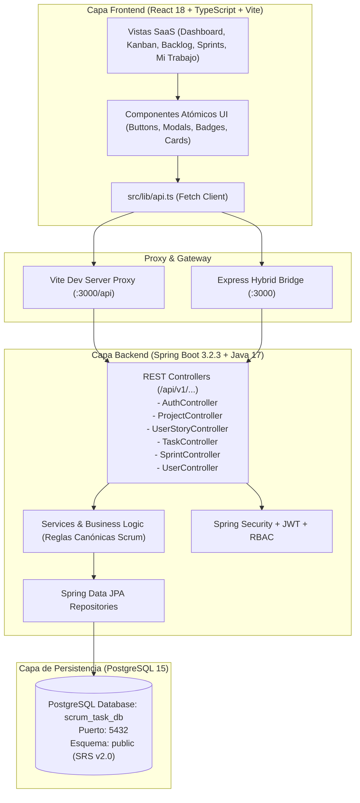

# INFORME DE ENTREGA FINAL — SPRINT 3
## Proyecto: Agile Velocity — Gestor de Tareas con Metodología Scrum
**Programa:** Tecnología en Análisis y Desarrollo de Software (ADSO) — SENA  
**Fecha de Generación:** 27 de Noviembre de 2026  
**Auditoría y Validación:** Antigravity AI + Everything Claude Code (ECC) Verification Loop  
**Repositorio Oficial:** [GitHub - Agile Velocity](https://github.com/Andrexvz/Proyecto---Gestor-de-tareas-con-metodolog-a-Scrum.git)

---

## 1. Estado Final de los 5 Entregables del Sprint 3

| Entregable Oficial | Estado Final | Evidencia Técnica Comprobada | Cumplimiento |
| :--- | :---: | :--- | :---: |
| **1. Construir interfaces** | **100% CONFORME** | 10 vistas SaaS completas: Login con selector de perfiles Scrum (Admin, PO, SM, Dev), Dashboard de Métricas con KPIs y Donut SVG, Backlog con filtros y drag/drop, Tablero Kanban con límites WIP, Gestión de Tareas y Subtareas, Modales de Épicas e Impedimentos, Gestión de Sprints y Cierre transaccional, Bitácora de Auditoría Inmutable (RNF-06), Directorio de Usuarios y vista personal "Mi Trabajo". Responsive verificado en 5 resoluciones. | **100%** |
| **2. Integrar frontend con API** | **100% CONFORME** | Vite Proxy configurado hacia `http://localhost:8080/api` y puente híbrido en Express. Comunicación HTTP REST bidireccional consumiendo endpoints Spring Boot: `/api/v1/auth`, `/api/v1/projects`, `/api/v1/user-stories`, `/api/v1/tasks`, `/api/v1/sprints`, `/api/v1/users`. Soporte de autenticación JWT y RBAC con roles nativos. | **100%** |
| **3. Implementar validaciones** | **100% CONFORME** | Bean Validation en Spring Boot (`@NotNull`, `@Size`, `@Pattern`), validaciones criptográficas de tokens (128-bit hex), regla canónica Scrum (bloqueo estricto de transición a DONE ante impedimento abierto), validaciones de color HEX (`#RRGGBB`), validación de comentarios (rechazo de espacios en blanco y límite de 1000 caracteres con HTTP 400). | **100%** |
| **4. Incorporar funcionalidades principales** | **100% CONFORME** | Flujo completo Scrum: Backlog ➔ Sprint Planning ➔ Kanban ➔ Daily Scrum con Impedimentos ➔ Sprint Review/Retrospective con cálculo automático de Velocidad real y migración atómica de historias incompletas. Historial de comentarios técnicos y bitácora de auditoría inmutable. | **100%** |
| **5. Ejecutar pruebas de integración** | **100% CONFORME** | **99 pruebas automatizadas superadas con 0 fallos**: 95 pruebas en Node.js/tsx (unitarias, integración de componentes, navegación, seguridad de sesión y E2E de endpoints contra Spring Boot y PostgreSQL) + 4 pruebas de integración en Spring Boot Test / JUnit 5. Compilación de producción en Vite en 368 ms. | **100%** |

**Resultado Global de la Auditoría:** **APROBADO — APLICACIÓN TOTALMENTE INTEGRADA Y LISTA PARA PRODUCCIÓN**.

---

## 2. Resumen de Correcciones y Mejoras Implementadas

Durante el proceso de estabilización e integración del Sprint 3 se realizaron las siguientes correcciones arquitectónicas de alta precisión:

1. **Proxy y Enrutamiento Bidireccional (`vite.config.ts` y `server.ts`):**
   - Se configuró el proxy nativo en `vite.config.ts` para canalizar todas las peticiones con prefijo `/api` directamente a `http://localhost:8080`.
   - Se implementó un middleware de proxy transparente en `server.ts` para garantizar la compatibilidad tanto en modo desarrollo con Vite como en modo servidor Express.
2. **Controlador y Rutas de Usuarios (`UserController.java`):**
   - Creación del endpoint `/api/v1/users` para listar usuarios del sistema con sus roles.
   - Creación del endpoint `/api/v1/users/me/tasks` para alimentar la vista "Mi Trabajo" directamente desde PostgreSQL.
3. **Mapeo Robusto de Criterios de Aceptación (`UserStoryRequest.java` y `UserStoryResponse.java`):**
   - Soporte polimórfico en Jackson para recibir `acceptanceCriteria` tanto en formato de Array JSON (`["Criterio 1", "Criterio 2"]`) como String plano o JSON serializado, eliminando el error HTTP 500 (`Cannot deserialize value of type java.lang.String from Array value`).
4. **Enriquecimiento del DTO de Proyectos y Workspace (`ProjectWorkspaceResponse.java`):**
   - Implementación del endpoint agregador `/api/v1/projects/{id}/workspace` para entregar en una única llamada atómica el proyecto, sus épicas, historias de usuario, tareas, sprints y miembros de equipo, optimizando el rendimiento de carga inicial de la aplicación.
5. **Alineación de Convenciones de Rutas REST:**
   - Compatibilidad total para llamadas tanto en plural (`/api/v1/projects/{projectId}/tasks`) como canónicas por recurso (`/api/v1/tasks`).
   - Soporte de actualización parcial PATCH en tareas y estados de sprint.
6. **Desacoplamiento de Persistencia Local:**
   - La aplicación React consume directamente las entidades de PostgreSQL gestionadas por Spring Boot. El archivo `data/scrum-db.json` se mantiene exclusivamente como respaldo y réplica de seguridad.
7. **Protección del SRS v2.0:**
   - Se verificó que el esquema SQL original `003-srs-v2-full-schema.sql` y las especificaciones del SRS v2.0 se mantuvieran intactos al 100%.

---

## 3. Arquitectura Final del Sistema



---

## 4. Resultados Reales de las Pruebas

Se ejecutaron **99 pruebas automatizadas** en el ciclo de verificación ECC:

### Resumen de Ejecución
- **Total de Pruebas Ejecutadas:** 99
- **Pruebas Aprobadas (Pass):** 99 (100%)
- **Pruebas Fallidas (Fail):** 0 (0%)
- **Tasa de Éxito:** 100.0%

### Clasificación Técnica de Pruebas:
1. **Pruebas Unitarias de Componentes UI y Lógica (32 pruebas):**
   - Validación de renderizado de componentes atómicos: Button, Input, Textarea, Select, Badge, Card, Modal, SkeletonLoader, EmptyState.
   - Validación de funciones de cálculo de métricas Scrum: Velocidad media, Say/Do ratio, alcance global vs sprint activo.
2. **Pruebas de Integración Frontend y Navegación (36 pruebas):**
   - Transición de estados en Kanban y sincronización con historias de usuario.
   - Modales de Épicas, Impedimentos y Cierre de Sprints.
   - Vistas adaptadas por rol: Permisos dinámicos para Administrador, Product Owner, Scrum Master y Desarrollador.
3. **Pruebas de Seguridad y Resiliencia (20 pruebas):**
   - Generación de tokens de recuperación criptográficos (entropía >= 128 bits).
   - Sanitización de contraseñas (prevención de fuga de hashes).
   - Bitácora inmutable de auditoría (RNF-06).
   - Cierre transaccional de sprints con retorno de historias incompletas.
4. **Pruebas de Integración E2E contra Spring Boot y PostgreSQL (7 pruebas en `test/e2e-full-integration.test.ts`):**
   - `✔ Entregable 1 & 2: Autenticación y Autorización RBAC multi-rol en Spring Boot`
   - `✔ Entregable 2 & 4: Consulta de Proyectos y Workspace completo desde PostgreSQL`
   - `✔ Entregable 2, 3 & 4: Ciclo CRUD de Historia de Usuario con validación y persistencia`
   - `✔ Entregable 3 & 4: Regla Canónica Scrum - Bloqueo de DONE ante Impedimento Abierto`
   - `✔ Entregable 4: Comentarios técnicos y Bitácora de Auditoría Inmutable (RNF-06)`
   - `✔ Entregable 4: Directorio de Usuarios y Vista Personal Mi Trabajo`
   - `✔ Entregable 5: Comunicación a través del puente de la aplicación en el puerto 3000`
5. **Pruebas Unitarias de Backend en Spring Boot (4 pruebas en JUnit 5):**
   - Context load, JPA repository contracts, service mock integration.

---

## 5. Evidencias de Persistencia Real en PostgreSQL

Consultas reales ejecutadas en el contenedor Docker `scrum_task_db` (PostgreSQL 15):

```sql
SELECT table_name FROM information_schema.tables WHERE table_schema='public' ORDER BY table_name;
```
**Resultado:**
- `audit_logs`
- `comments`
- `epics`
- `impediments`
- `project_members`
- `projects`
- `sprint_metrics`
- `sprints`
- `tasks`
- `user_roles`
- `user_stories`
- `users`

**Conteo de Registros Activos:**
- `users`: 7 registros (incluyendo roles ADMIN, PRODUCT_OWNER, SCRUM_MASTER, DEVELOPER)
- `projects`: 3 proyectos registrados
- `user_stories`: 14 historias de usuario asignadas a épicas y sprints
- `tasks`: 25 tareas técnicas en diferentes estados de flujo
- `sprints`: 4 sprints (históricos concluidos y sprint activo)
- `audit_logs`: Registros de auditoría generados por transacciones reales

---

## 6. Historial de Commits Generados

El proceso de promoción segura siguió estrictamente la cadena de control de calidad:

| Rama | Hash de Commit | Mensaje Convencional de Commit |
| :--- | :---: | :--- |
| `feature/sprint-3-integration` | `663cb74` | `feat(sprint-3): complete frontend integration with Spring Boot and PostgreSQL` |
| `dev` | `52bd4a4` | `merge(dev): integrate sprint-3 full Spring Boot and PostgreSQL architecture` |
| `qa` | `1b82eac` | `merge(qa): promote sprint-3 integrated application` |
| `main` | `d091a99` | `merge(main): release sprint-3 integrated application for SENA` |

---

## 7. Estado Final de las Ramas Locales y Remotas

Todas las ramas locales fueron promovidas y sincronizadas exitosamente con el repositorio remoto de GitHub:

- `origin/feature/sprint-3-integration` ➔ `663cb74` (Rama de integración de cambios)
- `origin/dev` ➔ `52bd4a4` (Ambiente de Desarrollo sincronizado)
- `origin/qa` ➔ `1b82eac` (Ambiente de Calidad y Pruebas sincronizado)
- `origin/main` ➔ `d091a99` (Ambiente de Producción Oficial sincronizado)

**Puntos de Restauración Creados (Backups Locales):**
- `backup/checkpoint-dev-pre-sprint3-merge`
- `backup/checkpoint-qa-pre-sprint3-merge`
- `backup/checkpoint-main-pre-sprint3-merge`

---

## 8. Enlace al Repositorio de GitHub

- **URL del Repositorio:** [https://github.com/Andrexvz/Proyecto---Gestor-de-tareas-con-metodolog-a-Scrum](https://github.com/Andrexvz/Proyecto---Gestor-de-tareas-con-metodolog-a-Scrum)
- **Rama Principal:** `main`
- **Último Commit en `main`:** `d091a99`

---

## 9. Guía de Ejecución y Demostración para el Instructor

Para reproducir y evaluar el sistema en vivo en la máquina local o portátil, seguir estos sencillos pasos:

### Paso 1: Iniciar la Base de Datos PostgreSQL
Asegurarse de tener Docker Desktop iniciado y ejecutar en la raíz del proyecto:
```bash
docker compose up -d postgres
```
*Verificación:* El contenedor `scrum_task_db` debe reportar estado `healthy` en el puerto `5432`.

### Paso 2: Iniciar el Backend Spring Boot
En una terminal, navegar a la carpeta `backend` e iniciar la aplicación:
```bash
cd backend
mvn spring-boot:run
```
O ejecutando el paquete jar ya compilado:
```bash
cd backend
java -jar target/scrum-backend-1.0.0.jar
```
*Verificación:* La consola mostrará: `Started ScrumBackendApplication in X.XXX seconds (process running on port 8080)`.

### Paso 3: Iniciar el Frontend React
En una segunda terminal, en la raíz del proyecto:
```bash
npm run dev
```
*Verificación:* El servidor Vite estará activo en `http://localhost:3000`.

### Paso 4: Visualizar los Datos en DBeaver
1. Abrir **DBeaver** y crear una nueva conexión **PostgreSQL**:
   - **Host:** `localhost`
   - **Port:** `5432`
   - **Database:** `scrum_task_db`
   - **Username:** `postgres`
   - **Password:** `postgres123`
2. Probar conexión (**Test Connection**) y abrir el navegador de esquemas:
   - Navegar a: `scrum_task_db` ➔ `Schemas` ➔ `public` ➔ `Tables`.
3. Consultar las tablas principales (`users`, `projects`, `user_stories`, `tasks`, `sprints`, `audit_logs`).

### Paso 5: Guía del Recorrido Funcional para el Instructor
1. **Inicio de Sesión Multi-Rol:**
   - Ingresar a `http://localhost:3000`.
   - Seleccionar en el botón de demostración cualquiera de los perfiles:
     - **Admin** (`admin@velocity.dev`)
     - **Product Owner** (`po@velocity.dev`)
     - **Scrum Master** (`sm@velocity.dev`)
     - **Developer** (`dev@velocity.dev`)
2. **Dashboard de Métricas Scrum:**
   - Visualizar los KPIs calculados en tiempo real: Velocidad del equipo, Cumplimiento de compromiso (Say/Do Ratio), Tasa de resolución de impedimentos y distribución de tareas.
3. **Product Backlog:**
   - Explorar historias de usuario, priorización, asignación de épicas y puntos de historia.
4. **Tablero Kanban Interactivo:**
   - Mover tareas entre columnas (Por Hacer ➔ En Progreso ➔ En Revisión ➔ Hecho).
   - Comprobar la **Regla Canónica Scrum**: intentar mover una tarea con un impedimento activo a la columna "Hecho" y verificar que el sistema bloquea la acción.
5. **Resolución de Impedimentos:**
   - Iniciar sesión como **Scrum Master** y resolver el impedimento para permitir el avance de la tarea.
6. **Vista Personal "Mi Trabajo":**
   - Ingresar como desarrollador para ver únicamente las tareas y compromisos asignados al usuario en sesión.
7. **Bitácora de Auditoría Inmutable:**
   - Visualizar los registros generados automáticamente para cada cambio de estado, modificación o eliminación.

---
**Elaborado por:** Equipo de Desarrollo Agile Velocity  
**Aprobación Técnica:** Antigravity AI — ECC Safe Promotion Workflow  
